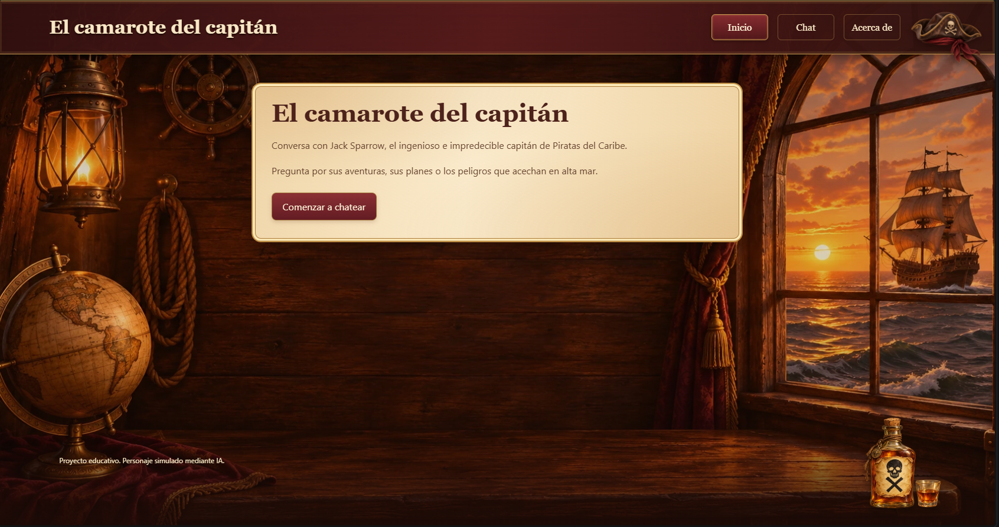
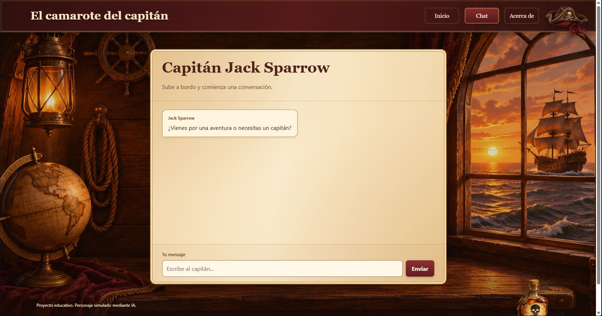
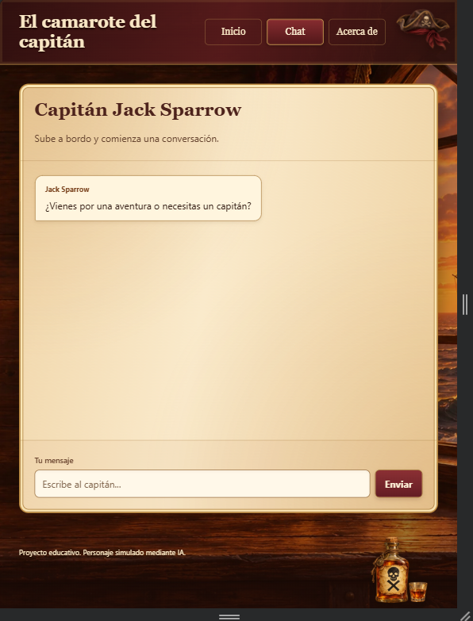
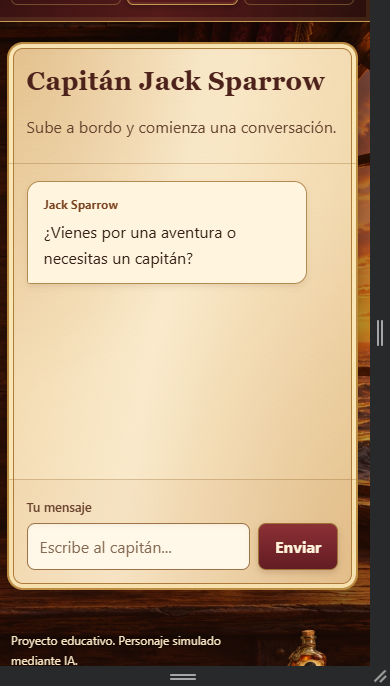
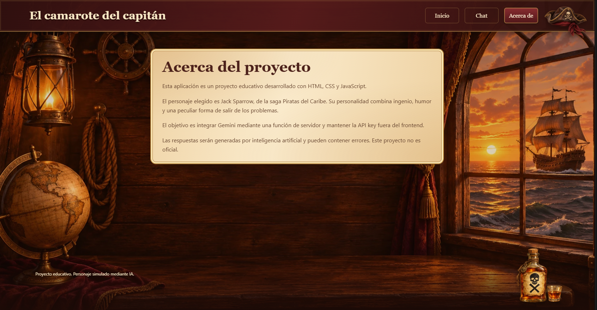

# El camarote del capitán

Proyecto Integrador 3: una Single Page Application (SPA) responsive para conversar con una versión ficticia del capitán Jack Sparrow mediante Google Gemini.

- **Aplicación:** https://camarote-del-capitan.vercel.app
- **Repositorio:** https://github.com/jose-reategui/Camarote-del-Capitan

## Personaje elegido

Jack Sparrow, de la saga *Piratas del Caribe*, se caracteriza por su ingenio, humor, teatralidad e imprevisibilidad. El system prompt le indica responder normalmente en español, con una a tres frases, mantener el contexto y utilizar referencias ocasionales a barcos, tesoros y aventuras. Ante temas modernos, reconoce sus límites o recurre a comparaciones piratas. Es una simulación educativa y no un producto oficial.

## Funcionalidades

- Rutas `/home`, `/chat` y `/about` renderizadas dinámicamente.
- Navegación con History API y evento `popstate`, incluidos atrás y adelante.
- Historial en memoria que se conserva al cambiar de vista y se reinicia al recargar.
- Mensajes del personaje y del usuario diferenciados visualmente.
- Envío mediante botón o Enter, validación de mensajes vacíos y scroll al último mensaje.
- Indicador de escritura y controles deshabilitados durante la petición.
- Manejo de errores de conexión, respuesta vacía y errores del servidor. Ante un fallo se restaura el mensaje en el input para volver a enviarlo.
- Diseño mobile-first con Flexbox, Grid y media queries en 768 px y 1200 px.
- Estética de pergamino cálido con camarote, barco, sombrero y botella decorativa con calavera y X.

## Tecnologías

HTML, CSS y JavaScript con módulos ES; Vite para desarrollo y build; Fetch API con async/await; Google Gemini; Vercel Functions; Vitest; Git y GitHub.

## Organización

El código está en `Desarrollo/` y la documentación en `Documentacion/`.

| Archivo o carpeta | Responsabilidad |
| --- | --- |
| `Desarrollo/api/functions.js` | Proxy seguro, validación, system prompt, transformación del historial y parseo de Gemini |
| `Desarrollo/src/index.html` | Contenedor HTML, header, navegación y footer |
| `Desarrollo/src/styles.css` | Estilos mobile-first, estados y decoraciones |
| `Desarrollo/src/assets/` | Fondo y decoraciones en WebP |
| `Desarrollo/src/app.js` | Rutas, renderizado de vistas y History API |
| `Desarrollo/src/chat.js` | Historial en memoria, formulario y renderizado de mensajes |
| `Desarrollo/src/utils.js` | Fetch al proxy y parseo de su respuesta |
| `Desarrollo/tests/utils.test.js` | Seis pruebas unitarias sin red |
| `Desarrollo/.env.example` | Nombres de variables sin valores reales |
| `Desarrollo/vercel.json` | Comandos, carpeta de salida y rewrites SPA |
| `Documentacion/Capturas/` | Capturas reales de la aplicación |

## Requisitos

- Node.js 24.x y npm.
- Git para clonar el repositorio.
- Una cuenta de Google AI Studio y una API key con acceso a un modelo de Gemini.
- Una cuenta de Vercel para ejecutar `vercel dev` y desplegar.

Los comandos siguientes usan PowerShell en Windows. Se utiliza `npm.cmd` y `npx.cmd` para evitar el bloqueo de scripts `.ps1`. En otros entornos pueden usarse `npm` y `npx`.

## Ejecución local

### 1. Clonar e instalar

```powershell
git clone https://github.com/jose-reategui/Camarote-del-Capitan.git
cd Camarote-del-Capitan\Desarrollo
npm.cmd ci
```

### 2. Configurar el entorno

Dentro de `Desarrollo`, copia el ejemplo:

```powershell
Copy-Item .env.example .env
```

Completa `.env` con tu clave real y el identificador de un modelo disponible para tu proyecto:

```dotenv
GEMINI_API_KEY=tu_clave_real
GEMINI_MODEL=gemini-3.5-flash
```

El nombre del modelo mostrado es el utilizado inicialmente en el proyecto; su disponibilidad y cuota dependen de la cuenta de Google. Si cambia, actualiza `GEMINI_MODEL` tanto localmente como en Vercel.

`.env` se encuentra junto a `package.json`, fuera de `src`. Está excluido de Git. `.env.example` debe conservar únicamente los nombres de las variables, sin claves ni valores reales.

### 3. Iniciar frontend y función

```powershell
npx.cmd vercel dev
```

En el primer inicio, sigue las indicaciones de autenticación y vinculación del proyecto en Vercel. Para una copia propia, vincula un proyecto de tu cuenta. Abre la dirección indicada por `Ready! Available at`, normalmente http://localhost:3000.

- Inicio: http://localhost:3000/home
- Chat: http://localhost:3000/chat
- Acerca de: http://localhost:3000/about

Mantén la terminal abierta. Para detener el servidor, presiona Ctrl + C. Después de cambiar variables de entorno, reinicia el servidor.

`npm.cmd run dev` inicia solo Vite: sirve para trabajar la interfaz, pero no ejecuta por sí solo la función de `/api`. Para probar el chat completo se utiliza `vercel dev`.

### Problemas encontrados en Windows

- **PowerShell bloquea npm.ps1:** ejecutar `npm.cmd` o `npx.cmd`.
- **EPERM al crear symlinks en la caché de Vercel:** se resolvió habilitando el Modo de desarrollador de Windows y reiniciando VS Code. Se puede abrir la configuración con Windows + R y `ms-settings:developers`.
- **Vercel espera mientras Vite arranca en otro puerto:** el comando de desarrollo en `vercel.json` pasa el puerto asignado con `npm run dev -- --port $PORT`.

## Pruebas unitarias

Desde `Desarrollo`:

```powershell
npm.cmd test
```

Se ejecuta `vitest run`. Las seis pruebas verifican:

1. Extracción de texto y eliminación de espacios en los extremos.
2. Rechazo de una respuesta sin `text`.
3. Rechazo de texto compuesto solo por espacios.
4. Envío del historial completo por POST y lectura de la respuesta.
5. Propagación del error informado por el servidor.
6. Propagación de un fallo de conexión.

Se reemplaza `fetch` mediante `vi.stubGlobal` y se restaura después de cada prueba con `vi.unstubAllGlobals`. No se usa la red, no se necesita una API key y no se consume cuota de Gemini. Las pruebas unitarias no sustituyen las comprobaciones manuales del chat y del despliegue.

## Build

```powershell
npm.cmd run build
```

Vite genera el frontend de producción en `Desarrollo/dist`. Vercel procesa por separado las funciones de `Desarrollo/api`. La carpeta `dist` no se sube a Git.

## Integración con Gemini y seguridad

El navegador envía `{ messages: [{ role, text }] }` por POST a `/api/functions`. La función valida el historial y lo transforma al formato `contents`, con roles `user` y `model`, y partes de texto. Omite el saludo inicial anterior al primer mensaje del usuario.

En cada petición se envía el historial de la conversación: Gemini no conserva por sí solo la memoria entre estas llamadas. La función agrega `systemInstruction`, consulta `generateContent` y transforma el resultado en `{ text }` para el cliente.

La API key se lee con `process.env.GEMINI_API_KEY` en el servidor y se envía a Google mediante el header `x-goog-api-key`. No se incluye en el JavaScript del navegador, no usa el prefijo `VITE_` y no se registra en Git. Los mensajes se muestran con `textContent` para no interpretar el texto como HTML.

La función acepta únicamente POST, valida los mensajes, aplica un timeout de 25 segundos y trata respuestas sin texto y errores de Gemini. Los errores 429 se muestran como límite de solicitudes. Los demás errores de Gemini se comunican con un mensaje genérico.

### Conceptos utilizados

- **Tokens:** unidades de texto que procesa el modelo. El historial y las respuestas consumen tokens; las conversaciones largas aumentan el contexto enviado.
- **Temperature:** parámetro que influye en la variación de las respuestas. Se configuró en `1`; no garantiza exactitud ni coherencia por sí solo.
- **Rate limiting:** límites de solicitudes o tokens impuestos por el proveedor. La aplicación maneja el estado 429, pero no implementa un limitador propio por usuario.

El proyecto no incorpora autenticación, base de datos ni persistencia con localStorage. El historial vive en memoria y se pierde al recargar. Una API key oculta no impide por sí sola que terceros llamen al endpoint público.

## Despliegue en Vercel desde GitHub

1. Subir el proyecto a un repositorio público de GitHub.
2. Crear un proyecto en Vercel o conectar el repositorio desde Settings > Git de un proyecto existente.
3. Configurar **Root Directory: `Desarrollo`**.
4. Verificar el framework **Vite**, Build Command **`npm run build`** y Output Directory **`dist`**. Estas opciones también se declaran en `vercel.json`.
5. Agregar `GEMINI_API_KEY` y `GEMINI_MODEL` en las variables del proyecto, para Production y Preview. En la interfaz utilizada están dentro de Settings > Environments.
6. Configurar `main` como rama de producción y crear el despliegue desde esa rama.
7. Esperar el estado Ready y abrir el dominio público.
8. Si se cambian variables de entorno, crear un nuevo despliegue para que surtan efecto.

Con el repositorio conectado, los siguientes pushes a la rama de producción generan nuevos despliegues. Las reglas de `vercel.json` permiten abrir directamente `/home`, `/chat` y `/about`.

## Comprobación manual

Antes de entregar, comprobar en la aplicación publicada:

- Conversación de varios turnos y recuerdo de un dato, por ejemplo el nombre del usuario.
- Personalidad del personaje y respuestas breves.
- Conservación del historial al cambiar de vista y reinicio al recargar.
- Navegación con enlaces y botones atrás/adelante.
- Apertura directa y recarga de `/chat`.
- Indicador de escritura, bloqueo de envíos simultáneos y scroll al último mensaje.
- Mensaje de error al fallar una petición.
- Diseño en 375 × 667, 768 × 1024 y 1440 × 900, sin desbordamiento horizontal.
- Acceso público en una ventana de incógnito y funcionamiento de la función en producción.

## Capturas de pantalla

Las imágenes siguientes deben corresponder a la versión final publicada. Se guardan en `Documentacion/Capturas` respetando nombres y mayúsculas.

### Inicio



### Chat en escritorio



### Chat en tablet



### Chat en celular



### Acerca del proyecto



## Registro del uso de IA

Se utilizó ChatGPT como apoyo para aprender, proponer código, resolver errores y generar recursos visuales. El trabajo se realizó por etapas: estructura, interfaz, routing, historial en memoria, integración segura, pruebas y despliegue. El personaje y la dirección visual fueron elegidos por el autor.

### Prompts y decisiones

Los textos entre comillas son solicitudes reales de la conversación. Las demás entradas resumen el objetivo de consultas desarrolladas durante el acompañamiento.

| Consulta o contexto proporcionado | Influencia en la implementación y decisión |
| --- | --- |
| Consigna completa: SPA con Home, Chat, About, Gemini, Vercel Functions y Vitest | Se optó por HTML, CSS y JavaScript sin framework de UI y por separar routing, chat y utilidades. |
| Elección: «jack sparrow, de la saga de los piratas del caribe» | Se definió el personaje y un system prompt con personalidad, idioma, límites de conocimiento y respuestas cortas. |
| Aclaración de que la documentación va por separado | Se mantuvo el código en Desarrollo y la documentación en Documentacion. |
| Ayuda con History API e historial de conversación | Se implementó pushState, popstate y un array de mensajes compartido durante la sesión. |
| Consulta sobre dónde colocar la clave real | Se distinguieron .env privado y .env.example sin valores; se mantuvo la llamada a Google en el servidor. |
| Errores EPERM/symlink y Vercel esperando al servidor | Se habilitó el modo de desarrollador y se corrigió devCommand para usar $PORT. |
| Ayuda para crear tests con Vitest y simular fetch | Se añadieron seis casos sobre parseo, historial enviado y errores, sin peticiones reales. |
| «Colores, el como se ve la pantalla [...] un barco pirata en el fondo [...] un gorrito [...] con una calavera [...] tambien un ron» | Se generaron referencias visuales y se eligió la dirección de pergamino cálido. |
| «a la botella de ron mejor ponle una calavera con una x, mejor que no diga ron» | Se generó una botella decorativa sin palabras, con una calavera y una X; fondo, sombrero y botella se exportaron como WebP. |
| «porque no esta centrado?» | Se ajustó el margen del panel en escritorio a margin-inline: auto según la preferencia del autor. |

### Evaluación de las sugerencias

Las propuestas se comprobaron mediante la ejecución local, pruebas de navegación e historial, una conversación que recuerda el nombre del usuario, seis tests unitarios y un build de producción. También se desplegó en Vercel y se verificó que Gemini respondiera en la aplicación publicada. El rediseño requiere su revisión visual final en los tres tamaños antes de tomar las capturas de entrega.

La IA propuso inicialmente un devCommand que no pasaba el puerto de Vercel; se corrigió al detectar el fallo. La ubicación de las variables de entorno en el dashboard también se ajustó según la interfaz real. Estos casos muestran por qué se revisaron las sugerencias y no se tomaron como correctas sin comprobarlas.

Los recursos visuales se generaron con IA. El mockup sirvió como referencia; la interfaz funcional está construida en HTML y CSS y utiliza las imágenes únicamente como decoración.
